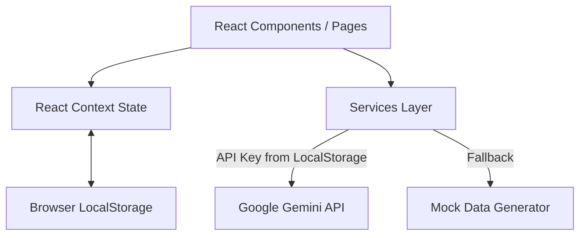

# COMPLETE PROJECT TECHNICAL AUDIT: InterviewIQ

## PART 1 — PROJECT OVERVIEW

### Simple Explanation
InterviewIQ is an AI-powered mock interview web application. It allows candidates to practice interviews across various roles (like Frontend, Backend, Data Science) by answering dynamically generated questions. The system can evaluate the candidate's answers, voice speed, and facial expressions, and then provide a detailed score and feedback report. 

### Technical Explanation
InterviewIQ is currently implemented as a **Frontend-Only Single Page Application (SPA)** using React and Vite. Despite the README outlining a full-stack architecture with a Node.js backend, PostgreSQL database, and Redis cache, the project in its current state is entirely client-side. It utilizes React Context for state management, `localStorage` for data persistence (mocking database behavior), and direct client-to-API calls to the Gemini API for its AI features. The backend and database do not exist in the source code; they are represented only by mock data and a SQL schema file.

---

## PART 2 — COMPLETE TECHNOLOGY STACK

| Technology | Purpose | Where It Is Used | Verified Status |
| ---------- | ------- | ---------------- | --------------- |
| **React** (v18.2.0) | Core frontend framework | Throughout `src/` | Verified |
| **Vite** (v5.1.4) | Build tool and dev server | `vite.config.js`, `package.json` | Verified |
| **Tailwind CSS** (v3.4.1) | Utility-first CSS styling | `tailwind.config.js`, UI components | Verified |
| **Lucide React** (v0.344.0) | UI Icons | UI components | Verified |
| **Recharts** (v2.12.2) | Data visualization and charts | Reports and Dashboard | Verified |
| **React Context** | State management | `src/context/` | Verified |
| **localStorage** | Persistent data storage | Context providers (`AuthContext.jsx`, `InterviewContext.jsx`) | Verified |
| **Gemini API** | AI question generation & answer evaluation | `src/services/aiEngine.js` | Verified (Direct Client-Side Call) |
| **Node.js / Express** | Backend API | `README.md` | **Not Implemented** |
| **PostgreSQL** | Database | `backend_schema.sql` (schema only) | **Not Implemented** |
| **Redis** | Caching | `README.md` | **Not Implemented** |

---

## PART 3 — COMPLETE PROJECT STRUCTURE

```text
c:\interviewiq\
├── README.md                 # Project documentation
├── backend_schema.sql        # Unused PostgreSQL schema design
├── package.json              # NPM dependencies and scripts
├── tailwind.config.js        # Tailwind CSS configuration
├── vite.config.js            # Vite configuration
└── src/
    ├── App.jsx               # Main application routing and layout
    ├── main.jsx              # Application entry point
    ├── index.css             # Global CSS and Tailwind directives
    ├── components/           # Reusable UI components (Navbar, Sidebar, etc.)
    ├── context/              # React Context (AuthContext, InterviewContext)
    ├── mock/                 # Mock data (mockData.js for simulated backend)
    ├── pages/                # Page-level components (Dashboard, Profile, etc.)
    └── services/             # Core business logic and external API integrations (aiEngine.js, etc.)
```

### Key Entry Points:
- **Application Startup:** `src/main.jsx` mounts the React application.
- **Routing:** Handled manually in `src/App.jsx` using a state variable (`currentPage`) rather than a routing library like React Router.
- **State Initialization:** `src/context/AuthContext.jsx` and `src/context/InterviewContext.jsx` initialize application state using mock data and `localStorage`.

---

## PART 4 — ARCHITECTURE AND SYSTEM DESIGN

### Actual Implemented Architecture
The application follows a **Client-Side SPA Architecture with Mocked Backend**. 

1. **Frontend to Backend Communication:** There is no backend. Services in `src/services/` act as a mock backend layer.
2. **Data Storage:** Data is stored in the browser's `localStorage` and synchronized with React state.
3. **External APIs:** The frontend communicates directly with the Google Gemini API (`https://generativelanguage.googleapis.com`) for AI features, circumventing a secure backend proxy.

### Architecture Diagram (Actual Implementation)



---

## PART 5 — FRONTEND DEEP ANALYSIS

### A. Pages and Routes
*Note: Routing is implemented via conditional rendering based on state in `App.jsx`, not URL paths.*
- **Dashboard (`/dashboard`):** Main landing page for authenticated users. Displays metrics, leaderboard, and recent activity.
- **NewInterview (`/new-interview`):** Configuration page to start a new mock interview (select role, difficulty, etc.).
- **InterviewSession (`/interview-session`):** The active interview interface. Handles question display, answer capture, and live evaluation.
- **InterviewReport (`/report`):** Detailed breakdown of scores, strengths, and improvements after an interview.
- **Profile (`/profile`):** User settings and resume management.
- **AdminPanel (`/admin`):** Mock administrative interface showing platform metrics and simulated users.

### B. State Management
- **`AuthContext`:** Manages user authentication state, profile data, and resume data. Persists to `localStorage` under `interviewiq_user`.
- **`InterviewContext`:** Manages active session state, past session history, generated questions, and AI evaluations. Persists past sessions to `localStorage` under `interviewiq_sessions`.

---

## PART 6 — BACKEND DEEP ANALYSIS

**Status:** The backend is completely missing from the codebase.
The `README.md` describes a Node.js/Express backend with endpoints like `POST /api/auth/login`, but none of this exists. API logic is entirely simulated in the frontend `src/services/` directory and `src/mock/mockData.js`.

### Security Vulnerability Observation
The Gemini API integration in `src/services/aiEngine.js` fetches an API key from `localStorage` and makes direct network requests to the Gemini API from the client. **This is a critical security vulnerability if used in production**, as it exposes the API key to the client's browser.

---

## PART 7 — DATABASE AND DATA MODEL

**Status:** The database is not implemented.
The file `backend_schema.sql` contains a well-structured PostgreSQL schema with tables for `users`, `resumes`, `interview_sessions`, `questions`, `answers`, and `scores`. However, the application only utilizes JavaScript objects in `src/mock/mockData.js` to simulate this structure.

---

## PART 8 — AUTHENTICATION AND USER ROLES

**Status:** Authentication is simulated.
- **Implementation:** `src/context/AuthContext.jsx` provides `login`, `signup`, and `logout` functions. These functions merely update the React state with mock user data and set a boolean `isAuthenticated` flag. 
- **Security:** There is no actual password hashing, JWT generation, or session validation.

---

## PART 9 — COMPLETE FEATURE INVENTORY

| Feature | Status | Notes |
| ------- | ------ | ----- |
| AI Question Generation | Partially Implemented | Uses Gemini API from client-side or falls back to mock data. |
| AI Answer Evaluation | Partially Implemented | Uses Gemini API from client-side or falls back to basic keyword matching. |
| User Authentication | UI only / Mocked | No real backend auth. |
| Dashboard & Analytics | Partially Implemented | Uses mock data and `localStorage` history. |
| Voice/Speech API | Unverified | Services exist (`speechService.js`) but backend/browser compatibility unverified. |
| Real-time Coding Sandbox | UI only | Component exists (`CodingSandbox.jsx`) but no backend execution environment. |
| Resume PDF Parsing | Unverified | `resumeParser.js` exists, relies on client-side mocking. |

---

## PART 10 — INTEGRATIONS AND EXTERNAL DEPENDENCIES

| Service | Purpose | Location | Status |
| ------- | ------- | -------- | ------ |
| **Google Gemini API** | Content generation and answer evaluation. | `src/services/aiEngine.js` | Implemented (Insecure client-side call) |

---

## PART 11 — ENVIRONMENT AND CONFIGURATION

- **Environment Variables:** None are currently required or configured in a `.env` file. The Gemini API key is expected to be provided by the user via the UI and stored in `localStorage`.
- **Start Command:** `npm run dev`
- **Build Command:** `npm run build`

---

## PART 12 — DEPENDENCY AND IMPACT ANALYSIS

### Impact Matrix

| File / Module | Responsibility | Depends On | Used By | Potential Change Impact |
| ------------- | -------------- | ---------- | ------- | ----------------------- |
| `App.jsx` | Main application routing | Contexts, Pages, Components | `main.jsx` | High. Changes break application navigation. |
| `AuthContext.jsx` | Simulated user state | `mockData.js` | Navbar, Routes | High. Will require complete rewrite when integrating a real backend. |
| `InterviewContext.jsx` | Interview session state | `aiEngine.js`, `mockData.js` | Session Pages | High. Core logic hub. |
| `aiEngine.js` | AI communication | `mockData.js` (for fallback) | `InterviewContext` | High. Needs refactoring to move API calls to a backend server. |

---

## PART 13 — TESTING, ERRORS, AND KNOWN ISSUES

- **Testing:** No testing frameworks (Jest, Cypress, etc.) are installed. There are no test files in the repository.
- **Error Handling:** Basic `try/catch` blocks in `aiEngine.js` with console warnings that fallback to mock data on failure.
- **Known Issues:** The application lacks a real backend, making it unsuitable for production.

---

## PART 14 — EXISTING TECHNICAL DEBT AND IMPROVEMENT OPPORTUNITIES

1. **Architecture Defect:** The application is purely client-side but relies on secrets (Gemini API key). **Required Action:** Build the promised Node.js backend to securely proxy Gemini API requests.
2. **Missing Backend & DB:** The SQL schema is designed but unused. **Required Action:** Implement the Express server and PostgreSQL database to replace `localStorage` and `mockData.js`.
3. **Routing Pattern:** Routing is handled via a `currentPage` state variable. **Required Action:** Implement React Router for proper URL management, deep linking, and browser history support.
4. **Testing Gap:** Zero test coverage. **Required Action:** Introduce unit tests and E2E tests.

---

## PART 15 — SAFE CHANGE GUIDELINES

1. **Before adding features:** Recognize that the current state is a prototype/mockup. Do not build complex business logic relying on `localStorage`.
2. **When implementing the Backend:** Start by replacing the functions in `AuthContext` and `InterviewContext` with standard `fetch` or `axios` calls to the new API endpoints.
3. **Moving AI to Backend:** Move the contents of `src/services/aiEngine.js` directly to the new Express backend to secure the API key.
4. **State Management:** When removing `localStorage`, ensure loading states are properly handled while waiting for network responses.

---

## PART 16 — FINAL HANDOFF SUMMARY FOR ANOTHER AI

### Project Identity
InterviewIQ is an AI mock interview prototype built entirely in React/Vite.

### Architecture at a glance
It is currently a **Frontend-Only SPA**. There is NO backend, NO database, and NO secure API routing. All state is mocked and stored in `localStorage`. The Gemini API is called insecurely from the browser.

### Current limitations
- **No Backend:** The advertised Node.js/Postgres backend does not exist.
- **Insecure AI Calls:** `aiEngine.js` requires the client to provide and store a Gemini API key.
- **Mocked Auth:** Login/Signup are purely UI illusions.

### Instructions for the next AI assistant
1. **Do not look for the Express server or database connection strings; they do not exist.**
2. If asked to implement the backend, use `backend_schema.sql` as the exact blueprint for the PostgreSQL database.
3. When migrating to a real backend, update `AuthContext.jsx` and `InterviewContext.jsx` to make network requests instead of writing to `localStorage`.
4. Prioritize moving the Gemini API integration (`src/services/aiEngine.js`) to a secure backend environment immediately to resolve the critical security flaw.
