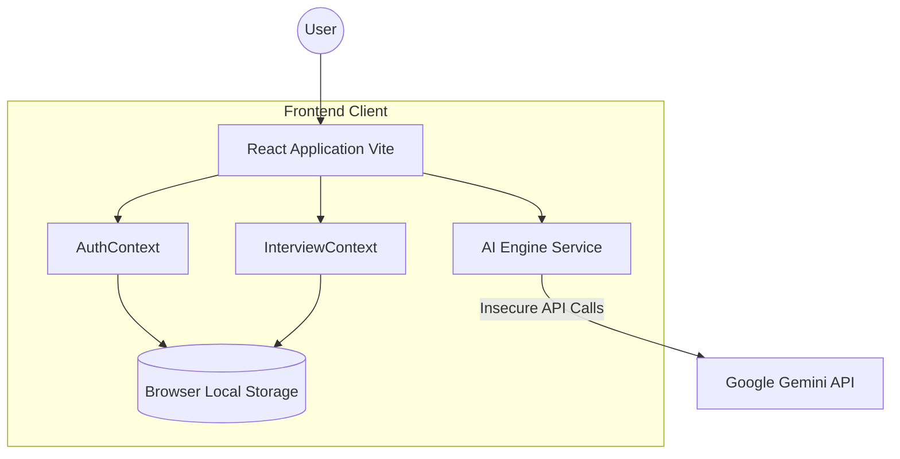
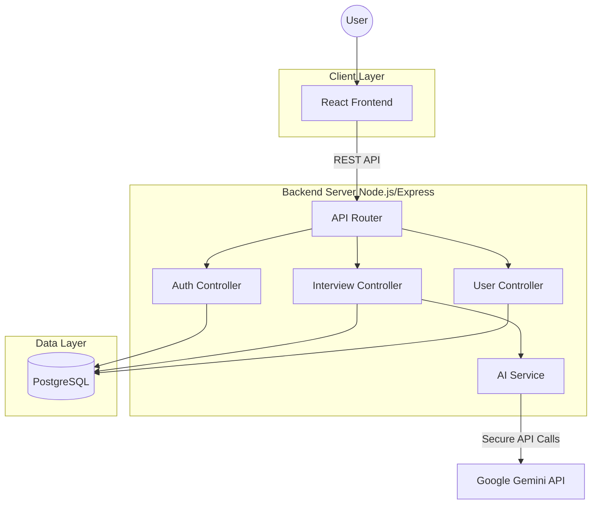
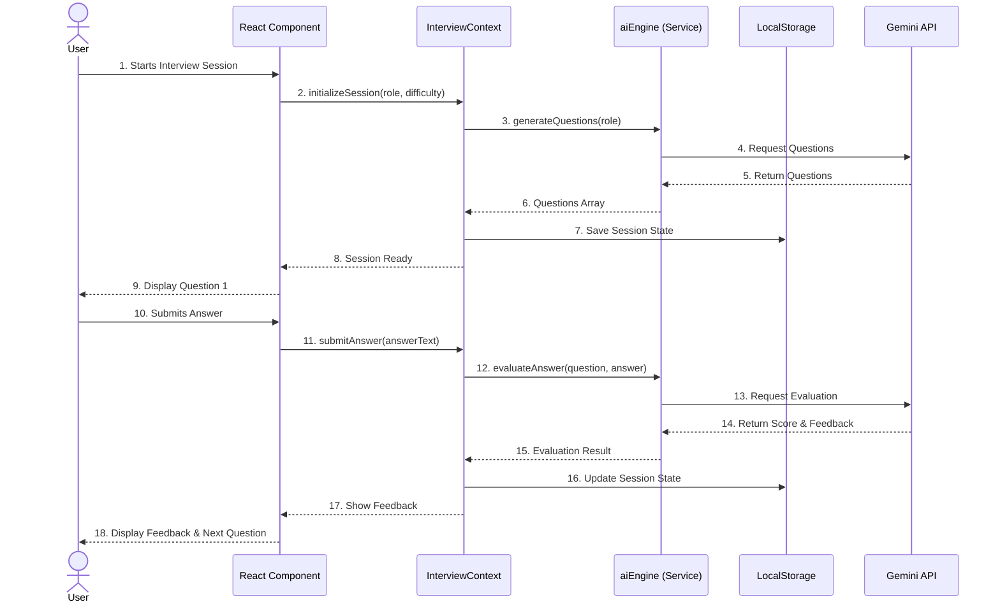
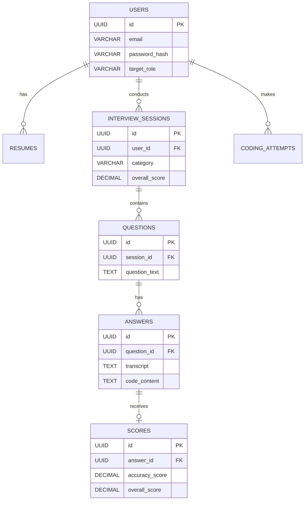

# JobDM System Architecture and Data Flow

This document outlines the system architecture and data flow for the JobDM platform based on its current implementation and the planned target architecture.

## 1. System Design Architecture

### 1.1 Current Architecture (Client-Side SPA)
Currently, JobDM operates entirely as a client-side Single Page Application (SPA). There is no operational backend server or database. State is managed via React Context and persisted in the browser's Local Storage. External API calls (like to the Google Gemini API) are made directly from the client.

### 1.2 Planned Target Architecture (Full-Stack)
The intended architecture (as inferred from the project documentation and SQL schema) involves a Node.js/Express backend with a PostgreSQL database. This resolves the security issue of exposing API keys on the client and allows for robust data persistence.

## 2. Data Flow Diagrams

### 2.1 Interview Session Data Flow (Current Implementation)
The following sequence diagram illustrates how data flows when a user starts an interview and submits an answer in the current client-side implementation.

### 2.2 Database Schema Entity Relationship (Planned)
Based on the `backend_schema.sql`, the planned database structure can be visualized as follows:

